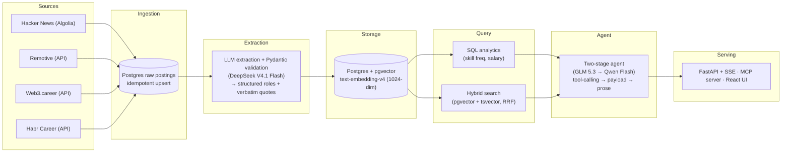

# Techanizer

An applied-AI tech job-market analyst. Techanizer ingests remote technology
vacancies from four heterogeneous boards — Hacker News *Who Is Hiring*, Remotive,
Web3.career, and Habr Career — extracts them into structured, searchable records
with verbatim grounding quotes, and answers free-text questions about the corpus
through a tool-calling agent.

The source is published to read — architecture, models, and evals. Running it
from source is not supported; the app is live at
[techanizer.tech](https://techanizer.tech).

## Architecture




## Models

| Stage | Model |
|---|---|
| Extraction | DeepSeek V4.1 Flash |
| Agent stage 1 (tool-calling) | GLM 5.3 |
| Agent stage 2 (prose) | Qwen 3.8 Flash (EN + RU) |
| Embeddings | Qwen3 text-embedding-v4 (1024-dim) |
| Eval judge | GLM 5.3 |


## Evaluation

Evaluations run against a frozen, byte-identical snapshot of the structured
corpus (`evals/snapshots/`), so results are reproducible and independent of the
live board.

| Eval | Metric | Score |
|---|---|---|
| Extraction (40 gold-labeled postings) | micro accuracy, exact-match | 87.3% |
| Grounding audit (12,598 values) | verbatim | 97% |
| Agent (3 runs per question) | pass rate | 59/60 |
| Retrieval (12 labeled queries, hybrid RRF) | MRR | 1.00 |
| Retrieval | precision@10 | 0.92 |
| Retrieval, bge-m3 baseline | MRR / precision@10 | 0.96 / 0.73 |
| Tests | unit / contract / serving / integration | 278 |

## Try it

The project is live at [techanizer.tech](https://techanizer.tech):

```bash
curl https://techanizer.tech/health
curl --get 'https://techanizer.tech/ask' \
  --data-urlencode 'q=What skills are common among senior backend roles?' \
  --data-urlencode 'lang=en'
```

## Deployment

The same image runs in production on an Aliyun ECS VM behind Caddy TLS: the
`Dockerfile` (Node build stage + Python runtime) builds one image,
`compose.prod.yml` runs it with db and caddy, and the `Caddyfile` fronts
`techanizer.tech` with automatic HTTPS.

## MCP access

The same three database-backed tools are also exposed through a stdio MCP
server (`techanizer/mcp/`).

## Project layout

```text
techanizer/ingestion/    board clients and loading
techanizer/extraction/   schemas, prompts, normalization, pipeline
techanizer/storage/      SQL analytics, embeddings, hybrid search
techanizer/agent/        tools, schemas, localization, model loop
techanizer/serving/      FastAPI and SSE streaming
techanizer/mcp/          FastMCP server
techanizer/ops/          scheduler and ingestion run log
frontend/                     React/Vite/Tailwind UI
db/schema/                    re-runnable database migrations
tests/                        unit, contract, serving, and integration tests
evals/                        frozen snapshots, gold data, and evaluations
docs/                         model documentation: card and BPMN diagrams
```

The installable package and its import name are both `techanizer`.

## Scope and limitations

- The corpus focuses on remote technology jobs and is biased toward startup,
  Web3, Hacker News, Remotive, and Habr communities.
- **Salary coverage is low (32%).** Most postings simply do not state pay; the
  agent reports this rather than estimating.
- **Seniority is unknown for 43% of roles** (HN 61%): the extractor reads stated
  levels only and refuses to guess.
- Currencies are kept in their stated currency and never converted.

## Validation

CI enforces ruff, mypy, and the full pytest suite on every push.
