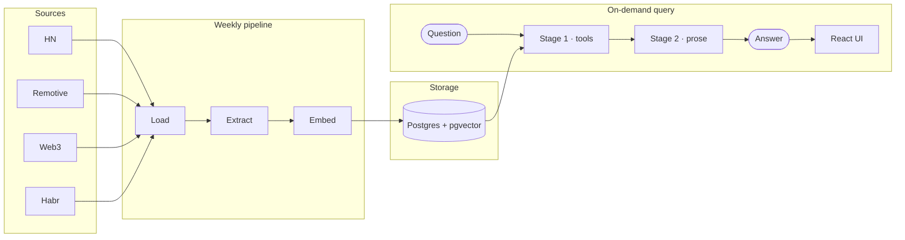

# Techanizer

An applied-AI tech job-market analyst. Techanizer ingests remote technology
vacancies from four heterogeneous boards — Hacker News *Who Is Hiring*, Remotive,
Web3.career, and Habr Career — extracts them into structured, searchable records
with verbatim grounding quotes, and answers free-text questions about the corpus
through a tool-calling agent.

It turns inconsistent English and Russian postings into a queryable market
picture:

- Which skills are most common among backend roles?
- What are the median salaries by currency or seniority?
- Which vacancies are semantically closest to a role description?

This is a production-oriented demonstration of integrating an LLM into a real
data pipeline: ingestion → structured extraction → vector storage → a typed,
tool-calling agent → a localized UI. The source mix is intentionally
heterogeneous; it is not a statistically representative model of the whole labor
market, and the agent answers *about the corpus*, refusing questions the data
cannot support.

## Architecture

```text
            Hacker News   Remotive   Web3.career   Habr Career
            (Algolia)      (API)       (API)          (API)
                    │          │           │              │
                    ▼          ▼           ▼              ▼
              ┌──────────────────────────────────────────────┐
              │   Postgres raw postings (idempotent upsert)  │
              └──────────────────────┬───────────────────────┘
                                     ▼
              ┌──────────────────────────────────────────────┐
              │  LLM extraction + Pydantic validation        │
              │  (DeepSeek V4 Flash)                         │
              │  → structured roles + verbatim source quotes │
              └──────────────────────┬───────────────────────┘
                                     ▼
              ┌──────────────────────────────────────────────┐
              │  Postgres + pgvector  ·  bge-m3 (1024-dim)   │
              └───────────────┬──────────────────┬───────────┘
                              ▼                  ▼
              ┌──────────────────────┐   ┌──────────────────────┐
              │  SQL analytics       │   │  HNSW vector search  │
              │  (skill freq, salary)│   │  (semantic match)    │
              └──────────┬───────────┘   └──────────┬───────────┘
                         └────────────┬─────────────┘
                                      ▼
              ┌──────────────────────────────────────────────┐
              │  Two-stage agent (DeepSeek V4 Pro → Kimi/DS)  │
              │  tool-calling → language-neutral payload      │
              │  → localized prose                            │
              └──────────────────────┬───────────────────────┘
                                     ▼
              ┌──────────────────────────────────────────────┐
              │  FastAPI + SSE  ·  MCP server  ·  React UI    │
              └──────────────────────────────────────────────┘
```

The end-to-end data flow, as a process:



## What is implemented

- Four ingestion adapters with idempotent upserts and source-specific parsing.
- Rolling 90-day live search window over a keep-everything corpus (history
  retained for trend analysis).
- Structured extraction of company, title, skills, seniority, remote policy,
  employment type, salary, and source quotes — every non-null field grounded by
  a verbatim substring of the posting.
- Skill normalization and aliasing across inconsistent source vocabulary.
- PostgreSQL + pgvector + HNSW vector search with local `bge-m3` embeddings.
- A typed two-stage agent: tool-calling produces a language-neutral payload; a
  second model writes English or Russian prose. Unsupported questions are
  refused rather than answered confidently wrong.
- Three scoped tools — `sql_query` (a named-query whitelist, no SQL crosses the
  model boundary), `vector_search`, `role_detail` — run sequentially under
  request/tool/token usage limits.
- SQL analytics, semantic search, SSE streaming, API-key gating, rate limiting,
  and MCP access.
- React UI with English/Russian output, light/dark themes, structured tables,
  evidence quotes, and explicit missing-data states.
- Weekly `load → extract → embed` scheduler with per-source run logging.

## Design principles

- **Grounded, not generated** — every non-null field is a verbatim substring of the posting.
- **Honest about gaps** — missing salary/seniority is reported, never imputed.
- **Two-stage agent** — language-neutral payload → localized prose; identical tables EN/RU.
- **Scoped tools** — `sql_query` is a named-query whitelist; no SQL crosses the model boundary.
- **Guardrails** — rate limit, spend cap, tool-call cap, API key.

## Models

| Stage | Model |
|---|---|
| Extraction | DeepSeek V4 Flash |
| Agent stage 1 (tool-calling) | DeepSeek V4 Pro |
| Agent stage 2 (prose) | DeepSeek V4 Pro (EN), Kimi K3 (RU) |
| Embeddings | `bge-m3` (1024-dim), local via Ollama |
| Eval judge | Kimi K3 |

All models are Chinese open-weight; the extraction batch uses the flash tier for
cost, while the agent's stage 1 runs on pro to hold the exact-cells contract.

## Data coverage

The corpus holds **1,973 roles / 1,390 postings** (Jul 14 – Oct 12 2026). Fields
are extracted only when the posting actually states them — the pipeline never
imputes a missing value, so coverage varies by source:

| Source | Roles | Salary stated | Seniority stated | Stack |
|---|---:|---:|---:|---:|
| Hacker News | 1,031 | 32% | 39% | 45% |
| Habr Career | 763 | 34% | 83% | 90% |
| Web3.career | 149 | 21% | 48% | 90% |
| Remotive | 30 | 40% | 57% | 100% |
| **Total** | **1,973** | **32%** | **57%** | **67%** |

HN *Who Is Hiring* is free-text and often lists a bare "we're hiring" with no
salary, level, or stack — which is why its coverage is low. This sparsity is a
property of the sources, not the pipeline: the agent reports coverage honestly
and withholds small-sample medians rather than inventing figures.

## Evaluation

Evaluations run against a frozen, byte-identical snapshot of the structured
corpus (`evals/snapshots/`), so results are reproducible and independent of the
live board.

- **Extraction accuracy** (40 gold-labeled postings, exact-match on discrete
  fields): seniority 94%, employment type 96%, remote policy 96%.
- **Grounding audit** (12,598 extracted values): 97% verbatim; the remainder are
  stitched bullet fragments, not fabrications.
- **Agent eval** (deterministic, semantic, refusal, injection, and cross-language
  probes, 3 runs each): 59/60 on the frozen snapshot.
- **Tests:** 233 unit/contract/serving/integration tests, plus the above LLM
  evals.

## Try it locally

### Requirements

- Python 3.13, [uv](https://docs.astral.sh/uv/), and Docker Compose
- PostgreSQL client (`psql`)
- A DeepSeek API key
- Ollama with the `bge-m3` embedding model
- A Web3.career API token if that source is enabled

### Install and configure

```bash
uv sync
cp .env.example .env
# Fill in DEEPSEEK_API_KEY, DATABASE_URL, and other required values.
set -a; . ./.env; set +a
```

Start PostgreSQL and apply the schema:

```bash
docker compose up -d
for f in db/schema/*.sql; do
  psql "$DATABASE_URL" -v ON_ERROR_STOP=1 -f "$f"
done
```

Load, extract, and embed postings (or run all three as one scheduled command):

```bash
uv run python -m techanizer.ingestion.load
uv run python -m techanizer.extraction.pipeline
uv run python -m techanizer.storage.embed

# equivalent one-shot scheduler:
uv run python -m techanizer.ops.scheduler
```

Start the API and UI:

```bash
uv run uvicorn techanizer.serving.app:app
```

Open `http://localhost:8000`. The API also exposes:

```bash
curl http://localhost:8000/health
curl --get 'http://localhost:8000/ask' \
  --data-urlencode 'q=What skills are common among senior backend roles?' \
  --data-urlencode 'lang=en'
```

If `ASK_API_KEY` is set, add `-H "Authorization: Bearer $ASK_API_KEY"` to the
second command. The browser key is intentionally only a shared demo gate, not
user authentication — it is visible to anyone who can load the frontend.

## MCP access

The same three database-backed tools are available through a stdio MCP server:

```bash
uv run python -m techanizer.mcp.server
```

Configure the MCP host with absolute paths and put `DATABASE_URL` and
`OLLAMA_BASE_URL` in the host's `env` block. The MCP server does not require a
DeepSeek key because the host supplies the model.

## Project layout

```text
techanizer/ingestion/    board clients and loading
techanizer/extraction/   schemas, prompts, normalization, pipeline
techanizer/storage/      SQL analytics, embeddings, vector search
techanizer/agent/        tools, schemas, localization, model loop
techanizer/serving/      FastAPI and SSE streaming
techanizer/mcp/          FastMCP server
techanizer/ops/          scheduler and ingestion run log
frontend/                     React/Vite/Tailwind UI
db/schema/                    re-runnable database migrations
tests/                        unit, contract, serving, and integration tests
evals/                        frozen snapshots, gold data, and evaluations
docs/                         roadmap and engineering decisions
```

The installable package and its import name are both `techanizer`.

## Scope and limitations

- The corpus focuses on remote technology jobs and is biased toward startup,
  Web3, Hacker News, Remotive, and Habr communities.
- Three sources are primarily English and one is Russian; this reflects legal
  source availability and provides a multilingual use case, not national
  language proportions.
- **Salary coverage is low (32%).** Most postings simply do not state pay; the
  agent reports this rather than estimating. Salary medians are withheld when a
  bucket has fewer than 30 roles, and roles whose currency was never stated are
  excluded from currency-filtered splits (never imputed).
- **Seniority is unknown for 43% of roles** (HN 61%): the extractor reads stated
  levels only and refuses to guess.
- Currencies are kept in their stated currency and never converted.

## Validation

```bash
uv run ruff check techanizer/ evals/ tests/
uv run mypy techanizer/ tests/
uv run pytest -q
cd frontend && npm run lint && npm run build
```
