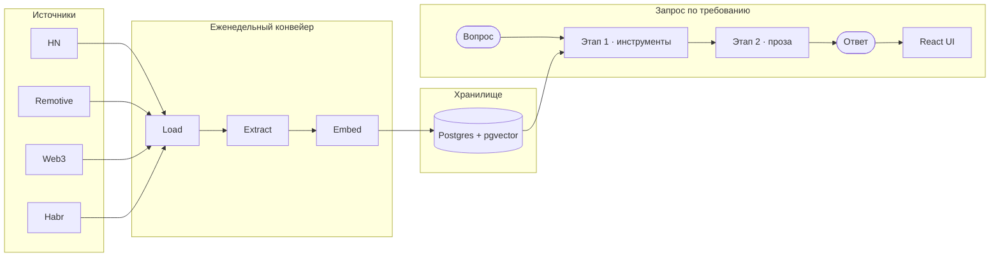

# Techanizer

Прикладной агент анализа рынка технических вакансий. Techanizer собирает
вакансии удалённой работы из четырёх источников — Hacker News
*Who Is Hiring*, Remotive, Web3.career и Habr Career — извлекает их в
структурированные, доступные для поиска данные с дословными
цитатами-обоснованиями и отвечает на вопросы о корпусе в свободной форме через
агента с вызовом инструментов.

Примеры вопросов на которые отвечает Techanizer:

- Какие навыки чаще всего встречаются в бэкенд-ролях?
- Какие медианные зарплаты по валютам или уровням грейда?
- Какие вакансии семантически ближе всего к описанию роли?

Проект демонстирует прикладную интеграцию LLM в реальный конвейер данных:
сбор → структурированное извлечение → векторное хранилище → типизированный
агент с вызовом инструментов → локализованный интерфейс. Состав источников
намеренно разнороден: это не статистически репрезентативная модель всего рынка
труда, а агент отвечает *о корпусе* и отказывается от вопросов, которые данные
не могут подтвердить.

## Архитектура

```text
            Hacker News   Remotive   Web3.career   Habr Career
            (Algolia)      (API)       (API)          (API)
                    │          │           │              │
                    ▼          ▼           ▼              ▼
              ┌──────────────────────────────────────────────┐
              │   Postgres raw postings (idempotent upsert)  │
              └──────────────────────┬───────────────────────┘
                                     ▼
              ┌──────────────────────────────────────────────┐
              │  LLM extraction + Pydantic validation        │
              │  (DeepSeek V4 Flash)                         │
              │  → structured roles + verbatim source quotes │
              └──────────────────────┬───────────────────────┘
                                     ▼
              ┌──────────────────────────────────────────────┐
              │  Postgres + pgvector  ·  bge-m3 (1024-dim)   │
              └───────────────┬──────────────────┬───────────┘
                              ▼                  ▼
              ┌──────────────────────┐   ┌──────────────────────┐
              │  SQL analytics       │   │  HNSW vector search  │
              │  (skill freq, salary)│   │  (semantic match)    │
              └──────────┬───────────┘   └──────────┬───────────┘
                         └────────────┬─────────────┘
                                      ▼
              ┌──────────────────────────────────────────────┐
              │  Two-stage agent (DeepSeek V4 Pro → Kimi/DS)  │
              │  tool-calling → language-neutral payload      │
              │  → localized prose                            │
              └──────────────────────┬───────────────────────┘
                                     ▼
              ┌──────────────────────────────────────────────┐
              │  FastAPI + SSE  ·  MCP server  ·  React UI    │
              └──────────────────────────────────────────────┘
```

Сквозной поток данных в виде процесса:



## Что реализовано

- Четыре адаптера сбора с идемпотентным upsert и парсингом под каждый источник.
- Скользящее 90-дневное окно поиска поверх корпуса с хранением всего (история
  сохраняется для анализа трендов).
- Структурированное извлечение компании, названия, навыков, грейда, формата
  работы, типа занятости, зарплаты и цитат-источников — каждое непустое поле
  обосновано дословным фрагментом объявления.
- Нормализация и алиасинг навыков поверх несогласованной лексики источников.
- PostgreSQL + pgvector + векторный поиск HNSW на локальных эмбеддингах `bge-m3`.
- Типизированный двухэтапный агент: вызов инструментов даёт языково-нейтральный
  payload; вторая модель пишет прозу на английском или русском. Вопросы вне
  возможностей данных отклоняются, а не получают уверенный неверный ответ.
- Три узких инструмента — `sql_query` (белый список именованных запросов, SQL
  не пересекает границу модели), `vector_search`, `role_detail` — выполняются
  последовательно под лимитами запросов, вызовов и токенов.
- SQL-аналитика, семантический поиск, поток SSE, защита по API-ключу, лимит
  частоты запросов и доступ через MCP.
- React-интерфейс с английским и русским выводом, светлой/тёмной темой,
  структурированными таблицами, цитатами и явными состояниями «данных нет».
- Еженедельный планировщик `load → extract → embed` с журналом запусков по
  каждому источнику.

## Принципы проектирования

- **Обосновано, а не выдумано** — каждое непустое поле — дословный фрагмент объявления.
- **Честно о пробелах** — отсутствующие зарплаты/грейды сообщаются, а не домысливаются.
- **Двухэтапный агент** — языково-нейтральный payload → локализованная проза; одинаковые таблицы EN/RU.
- **Узкие инструменты** — `sql_query` — белый список запросов; SQL не пересекает границу модели.
- **Защита** — лимит частоты, лимит расходов, лимит вызовов, API-ключ.

## Модели

| Этап | Модель |
|---|---|
| Извлечение | DeepSeek V4 Flash |
| Агент, этап 1 (вызов инструментов) | DeepSeek V4 Pro |
| Агент, этап 2 (проза) | DeepSeek V4 Pro (EN), Kimi K3 (RU) |
| Эмбеддинги | `bge-m3` (1024 измерения), локально через Ollama |
| Судья в оценках | Kimi K3 |

Все модели — китайские open-weight. Пакетное извлечение использует flash-уровень
ради стоимости, а этап 1 агента работает на pro, чтобы удерживать точный
контракт ячеек.

## Покрытие данных

Корпус содержит **1 973 роли / 1 390 вакансий** (14 июля – 12 октября 2026).
Поля извлекаются только тогда, когда объявление их реально указывает — конвейер
никогда не домысливает пропущенные значения, поэтому покрытие зависит от
источника:

| Источник | Роли | Указана зарплата | Указан грейд | Навыки |
|---|---:|---:|---:|---:|
| Hacker News | 1 031 | 32% | 39% | 45% |
| Habr Career | 763 | 34% | 83% | 90% |
| Web3.career | 149 | 21% | 48% | 90% |
| Remotive | 30 | 40% | 57% | 100% |
| **Итого** | **1 973** | **32%** | **57%** | **67%** |

HN *Who Is Hiring* — свободный текст, часто короткое «набираем людей» без
зарплаты, грейда и стека, поэтому его покрытие низкое. Эта разреженность —
свойство источников, а не конвейера: агент честно сообщает о покрытии и не
выводит медианы на малых выборках вместо того, чтобы выдумывать цифры.

## Оценка качества

Оценки выполняются на замороженном, байт-в-байт идентичном снимке
структурированного корпуса (`evals/snapshots/`), поэтому результаты
воспроизводимы и не зависят от живых досок.

- **Точность извлечения** (40 размеченных объявлений, точное совпадение по
  дискретным полям): грейд 94%, тип занятости 96%, формат работы 96%.
- **Аудит обоснованности** (12 598 извлечённых значений): 97% дословны; остальное
  — склеенные фрагменты списков, а не выдумка.
- **Оценка агента** (детерминированные, семантические, отказные, инъекционные и
  кросс-языковые пробы, по 3 прогона): 59/60 на замороженном снимке.
- **Тесты:** 233 модульных/контрактных/serving/интеграционных теста плюс
  перечисленные LLM-оценки.

## Локальный запуск

### Требования

- Python 3.13, [uv](https://docs.astral.sh/uv/) и Docker Compose
- Клиент PostgreSQL (`psql`)
- API-ключ DeepSeek
- Ollama с моделью эмбеддингов `bge-m3`
- Токен Web3.career, если этот источник включён

### Установка и настройка

```bash
uv sync
cp .env.example .env
# Заполните DEEPSEEK_API_KEY, DATABASE_URL и остальные обязательные значения.
set -a; . ./.env; set +a
```

Запустите PostgreSQL и примените схему:

```bash
docker compose up -d
for f in db/schema/*.sql; do
  psql "$DATABASE_URL" -v ON_ERROR_STOP=1 -f "$f"
done
```

Загрузите, извлеките и встройте объявления (или выполните всё одной командой
планировщика):

```bash
uv run python -m techanizer.ingestion.load
uv run python -m techanizer.extraction.pipeline
uv run python -m techanizer.storage.embed

# эквивалентный однокомандный планировщик:
uv run python -m techanizer.ops.scheduler
```

Запустите API и интерфейс:

```bash
uv run uvicorn techanizer.serving.app:app
```

Откройте `http://localhost:8000`. API также предоставляет:

```bash
curl http://localhost:8000/health
curl --get 'http://localhost:8000/ask' \
  --data-urlencode 'q=What skills are common among senior backend roles?' \
  --data-urlencode 'lang=en'
```

Если задан `ASK_API_KEY`, добавьте `-H "Authorization: Bearer $ASK_API_KEY"` ко
второй команде. Ключ в браузере намеренно лишь общий демо-шлюз, а не
аутентификация пользователей — он виден любому, кто может загрузить фронтенд.

## Доступ через MCP

Те же три инструмента, работающие с базой, доступны через stdio MCP-сервер:

```bash
uv run python -m techanizer.mcp.server
```

Настройте MCP-хост абсолютными путями и положите `DATABASE_URL` и
`OLLAMA_BASE_URL` в блок `env` хоста. MCP-серверу не нужен ключ DeepSeek, потому
что модель предоставляет хост.

## Структура проекта

```text
techanizer/ingestion/    клиенты досок и загрузка
techanizer/extraction/   схемы, промпты, нормализация, конвейер
techanizer/storage/      SQL-аналитика, эмбеддинги, векторный поиск
techanizer/agent/        инструменты, схемы, локализация, цикл модели
techanizer/serving/      FastAPI и поток SSE
techanizer/mcp/          FastMCP-сервер
techanizer/ops/          планировщик и журнал запусков
frontend/                интерфейс React/Vite/Tailwind
db/schema/               перезапускаемые миграции базы данных
tests/                   модульные, контрактные, serving и интеграционные тесты
evals/                   замороженные снимки, золотые данные и оценки
docs/                    роадмап и инженерные решения
```

Устанавливаемый пакет и его имя импорта — `techanizer`.

## Границы и ограничения

- Корпус сфокусирован на удалённых технических вакансиях и смещён в сторону
  стартапов, Web3, Hacker News, Remotive и Habr.
- Три источника в основном англоязычные и один русскоязычный; это отражает
  доступность источников и даёт мультиязычный кейс, а не реальные пропорции
  языков.
- **Покрытие зарплат низкое (32%).** Большинство объявлений просто не указывают
  оплату; агент сообщает об этом, а не оценивает. Медианы зарплат скрываются,
  когда в корзине меньше 30 ролей, а роли без указанной валюты исключаются из
  разбивок по валюте (никогда не домысливаются).
- **Грейд неизвестен для 43% ролей** (HN — 61%): экстрактор читает только явно
  указанный уровень и отказывается угадывать.
- Валюты хранятся в исходной валюте и никогда не конвертируются.

## Проверка

```bash
uv run ruff check techanizer/ evals/ tests/
uv run mypy techanizer/ tests/
uv run pytest -q
cd frontend && npm run lint && npm run build
```
