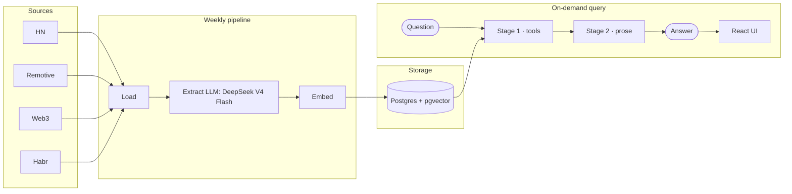

# Architecture (роль модели в техническом процессе)

Диаграмма основана на схеме потока данных из README проекта.

Краткое описание
- Задача модели: преобразовать вакансии из разных источников в единый структурированный формат, пригодный для фильтрации, аналитики и поиска.
- Почему используется LLM: описания вакансий различаются по структуре и языку; LLM может извлекать поля из свободного текста без отдельной модели для каждого источника.
- Вход: очищенный текст вакансии или комментария. Для некоторых источников часть полей уже приходит в структурированном виде и берётся непосредственно из данных источника.
- Выход: проверенный JSON с полями вакансии и фрагменты исходного текста; далее данные нормализуются и сохраняются.
- Использование результата: SQL-аналитика и векторный поиск предоставляют данные агенту, который формирует ответ на вопрос пользователя.
