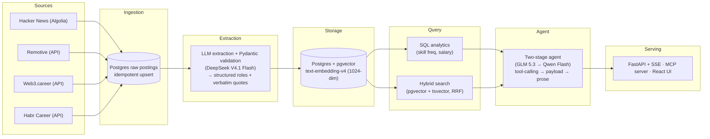

# Architecture (роль модели в техническом процессе)

Диаграмма основана на схеме потока данных из README проекта.

1. На вход в Postgres поступают сырые данные из 4 источников.
2. DeepSeek V4.1 Flash извлекает структуру по системному промпту, вывод проходит Pydantic-валидацию; после нормализации данные сохраняются в таблицу структурированных ролей.
3. Хранение: каждая роль получает эмбеддинг text-embedding-v4 и сохраняется в pgvector.
4. Запросы: SQL-аналитика (частота навыков, распределения зарплат с медианами); гибридный поиск (векторный и лексический).
5. Агент, две стадии. Первая — GLM 5.3, вызов инструментов: модель выбирает из трёх (SQL-запрос, векторный поиск, детальная о роли) и заполняет payload (таблицы, цитаты, факты). Вторая — Qwen 3.8 Flash: превращает payload в текст ответа на нужном языке.
6. Вывод: FastAPI стримит ответ по SSE в React-интерфейс; тот же набор инструментов доступен отдельным MCP-сервером.
