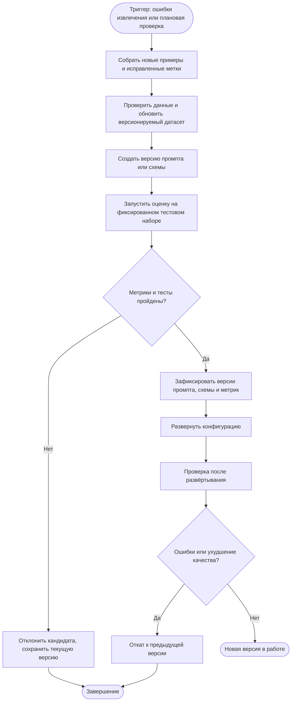

# Model Retrain (обновление конфигурации извлечения Techanizer)

В Techanizer используются модели через API, поэтому в проекте отсуствует фаза переобучения. Ниже описан предлагаемый процесс улучшения промпта и конфигурации извлечения.

## Схема процесса

## Этапы процесса

1. **Триггер.** Плановая проверка качества либо обнаружение повторяющихся ошибок извлечения.
2. **Данные.** Собираются новые вакансии и эталонные метрики; проверяется соответствие схеме.
3. **Кандидат.** Изменяется промпт, правила нормализации или схемы.
4. **Оценка.** Кандидат сравнивается с текущей версией на одной и той же фиксированной выборке.
5. **Решение.** Кандидат принимается только при прохождении заранее заданных критериев и отсутствии критических ошибок. Иначе сохраняется текущая версия.
6. **Регистрация и развёртывание.** Сохраняются версии модели, промпта, схемы, нормализации и результаты оценки; после этого конфигурация отправляется в работу.
7. **Контроль и откат.** После развёртывания проверяются ошибки и качество. При ухудшении выполняется откат к предыдущей конфигурации.

Это проектируемый процесс обновления промпта/конфигурации, а не уже реализованное автоматическое переобучение весов. Для надёжной оценки нужен отдельный тестовый набор, не используемый для настройки промпта.
