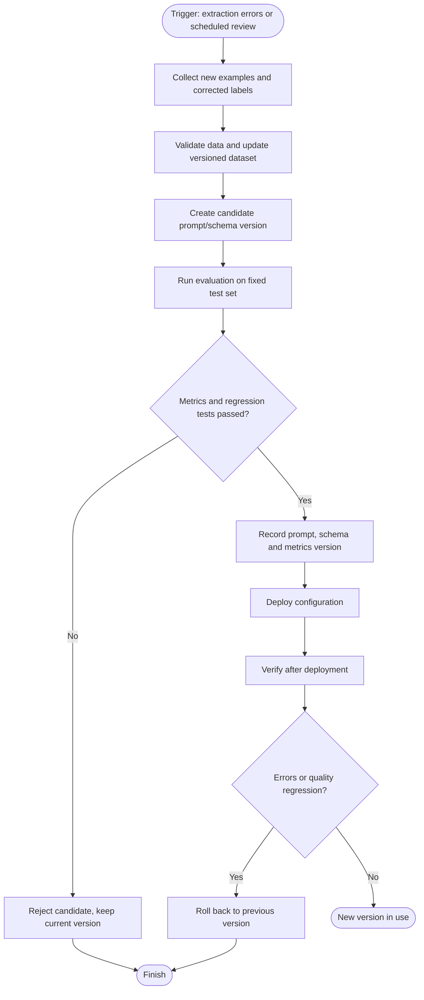

# Model Retrain (обновление конфигурации извлечения Techanizer)

В Techanizer используется API-модель, поэтому проект не переобучает её параметры. Ниже описан предлагаемый процесс улучшения промпта и конфигурации извлечения, который соответствует жизненному циклу обновления используемой модели.

## Схема процесса

## Этапы процесса

1. **Триггер.** Плановая проверка качества либо обнаружение повторяющихся ошибок извлечения.
2. **Данные.** Собираются новые вакансии и эталонные метки; проверяются дубликаты, полнота и соответствие схеме.
3. **Кандидат.** Инженер изменяет промпт, правила нормализации или схему.
4. **Оценка.** Кандидат сравнивается с текущей версией на одном и том же фиксированном наборе. Проверяются точность данных по ключевым сценариям.
5. **Решение.** Кандидат принимается только при прохождении заранее заданных порогов и отсутствии критических ошибок. Иначе сохраняется текущая версия.
6. **Регистрация и развёртывание.** Сохраняются версии модели-провайдера, промпта, схемы, нормализации и результаты оценки; после этого конфигурация выпускается в рабочий конвейер.
7. **Контроль и откат.** После развёртывания проверяются ошибки и качество. При ухудшении выполняется откат к предыдущей конфигурации.

**Важно:** это проектируемый процесс обновления промпта/конфигурации, а не уже реализованное автоматическое переобучение весов. Для надёжной оценки нужен отдельный тестовый набор, не используемый для настройки промпта.
